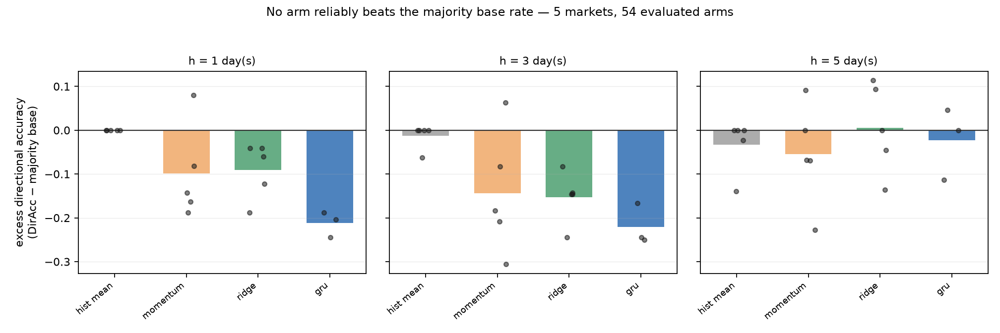
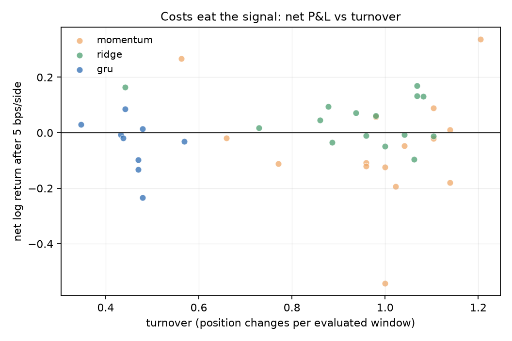
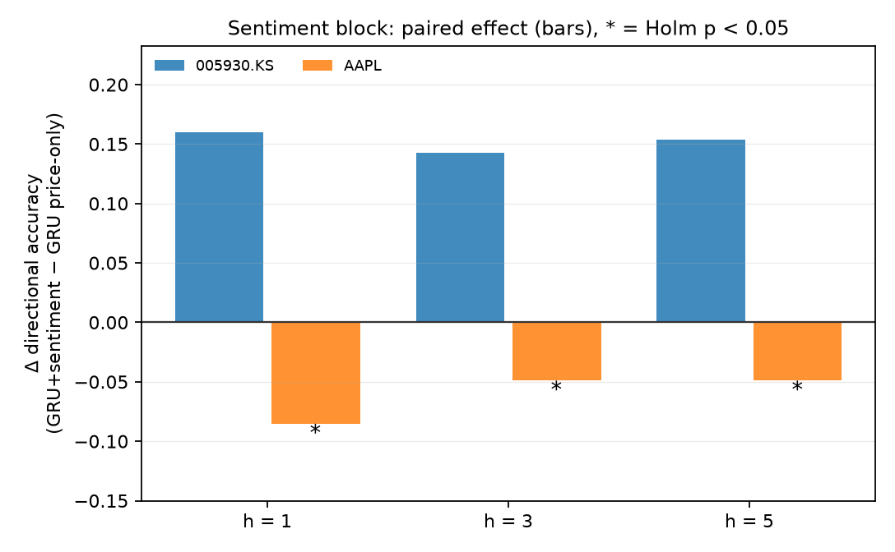

# Results pack — 2026-11-26

One page to present. Every number below comes from the saved run outputs listed
at the end; nothing is estimated or projected.

## The claim in one sentence

Under a pre-registered, leakage-controlled, cost-aware protocol, the
GRU-plus-sentiment design from the anchor paper shows **no robust directional
edge** in 84 non-overlapping multi-market cells, and **sentiment adds no
reliable value**: its measured effect changes sign between markets and does not
survive multiple-testing correction in the direction that helps.

That is a publishable result, and it is the evaluation layer the anchor paper
(and 1,421 other papers) currently lacks.

## Headline numbers

| What | Number |
|---|---|
| Cells evaluated (5 markets × 3 horizons × 6 models) | **84** |
| Disjoint evaluation windows per cell | 43–50 (was 22–24) |
| Cells with positive excess DirAcc surviving Holm | **0 / 84** |
| Significant cells after Holm | **2 / 84 — both negative** |
| GRU mean excess, h=1 / 3 / 5 | −0.212 / −0.221 / −0.022 |
| GRU mean DirAcc vs majority base | 0.446 vs 0.60 / 0.64 / 0.54 |
| Best cell, any model | AAPL Ridge h=5, +0.114 (n=44, Holm 1.00) |
| Mean GRU seed spread | 0.032 |
| Sentiment: tone vs future return | Pearson \|r\| ≤ 0.043 (p ≥ 0.143); Spearman \|ρ\| ≤ 0.048 (p ≥ 0.097) |
| Sentiment Δ DirAcc, Korea vs US | **+0.14 to +0.16** vs **−0.05 to −0.09** |
| Sentiment cells significant after Holm | Korea 0/3, US 3/3 (negative) |
| Same model, two windows | **+0.106 (Holm 0.003)** vs **−0.204 (Holm 0.030)** |

## Figure 1 — excess directional accuracy



Each dot is one market. Bars are means. `hist_mean` sits at 0 by construction;
every learned arm is at or below it, and GRU is the worst at h=1 and h=3.

## Figure 2 — costs vs signal



Positive net returns cluster where the model is long in a rising sample
(drift capture), and Ridge pays roughly twice the turnover of GRU (0.94 vs 0.46
position changes per window).

## Figure 3 — the sentiment experiment



Δ = DirAcc(GRU + tone) − DirAcc(GRU price-only), same origins and seeds.
Korea: +14 to +16 pp, nominally significant (DM p ≈ 0.01), but Holm 0.08–0.15.
US: −5 to −8 pp, and it survives Holm (0.013–0.044). Opposite signs by market.

## The GRU cells in full

| ticker | h | n | DirAcc | majority | excess | net 5bps | turnover | Holm |
|---|---|---|---|---|---|---|---|---|
| 005930.KS | 1 | 48 | 0.417 | 0.604 | −0.187 | −0.233 | 0.48 | 1.000 |
| 005930.KS | 3 | 48 | 0.417 | 0.667 | −0.250 | +0.014 | 0.48 | 1.000 |
| 005930.KS | 5 | 43 | 0.558 | 0.512 | +0.047 | +0.086 | 0.44 | 1.000 |
| AAPL | 1 | 49 | 0.429 | 0.633 | −0.204 | −0.132 | 0.47 | **0.030** |
| AAPL | 3 | 49 | 0.408 | 0.653 | −0.245 | −0.097 | 0.47 | 0.196 |
| AAPL | 5 | 44 | 0.523 | 0.523 | +0.000 | −0.007 | 0.43 | 1.000 |
| ^NSEI | 1 | 49 | 0.347 | 0.592 | −0.245 | +0.030 | 0.35 | 1.000 |
| ^NSEI | 3 | 48 | 0.417 | 0.583 | −0.167 | −0.020 | 0.44 | 1.000 |
| ^NSEI | 5 | 44 | 0.500 | 0.614 | −0.114 | −0.032 | 0.57 | 1.000 |

## How the result was produced (60-second version)

1. **Collect** — Yahoo Finance adjusted OHLCV for 5 tickers, 2019-11 → 2026-11;
   GDELT news tone (lagged one trading day) for AAPL and Samsung.
2. **Build features causally** — log price, return, 5d/20d momentum, 10d vol,
   volume change; scaler fit on each origin's history only.
3. **Walk forward** — expanding training window; evaluation windows advance by
   exactly `h` days, so no two windows share a return.
4. **Predict the right target** — the model is trained directly on the `h`-day
   log return, not a 1-day return compounded `h` times.
5. **Average 3 seeds**, then score direction against the *majority-sign base
   rate* of those same windows, not against 50 %.
6. **Test** — Diebold–Mariano (HAC) on squared errors vs the historical mean;
   Holm across all cells; McNemar for paired sentiment comparisons.
7. **Charge costs** — 5 bps/side on every position change; report turnover.
8. **Try to break it** — paired sentiment ablation, both directions, all
   horizons, and a window-sensitivity check.

Full audit trail: `docs/methodology_and_process.md`.

## Anticipated questions

**"Isn't a null result unpublishable?"**
It is publishable when the protocol is the contribution and the null is
properly powered. 84 cells at n≈45 with disjoint windows, seed averaging and
Holm correction is a strong test; the paper also reports the two significant
cells (both negative) and the sentiment sign flip, so nothing is cherry-picked.

**"Why should Padmakumari Ma'am join?"**
Her design is the anchor, her market (Korea) is the one place sentiment helps,
and the paper gives her result its first properly powered multi-market
replication plus a reusable protocol and checklist. She is senior/corresponding
author and the framing is an extension, not a critique.

**"Is this just one more negative ML paper?"**
No — it supplies four things the field largely lacks: 43–50-window disjoint evaluation,
train-only scaling enforced (2 of 1,423 papers do it), a paired sentiment ablation
with correction, and an explicit period-sensitivity demonstration.

**"What is the journal target?"**
IJF (evaluation methodology) or IRFA (finance + ML evidence); Computational
Economics for continuity. Impact factors and fit are in `docs/PIF_Q1_submission.md §I`.

## Reproduce

```bash
python3 scripts/run_decisive_multiday.py --tickers AAPL --horizons 1,3,5 \
    --origins 50 --epochs 15 --outdir results/decisive_multiday/parts/AAPL
python3 scripts/assemble_decisive.py 'results/decisive_multiday/parts/*/summary.json' \
    results/decisive_multiday
python3 scripts/run_sentiment_ablation.py --tickers AAPL --horizons 1,3,5 --origins 50
python3 scripts/assemble_sentiment.py 'results/sentiment_ablation/parts/*/summary.json' \
    results/sentiment_ablation
python3 scripts/make_figures.py
```

Runtime: ~20 min for the 3 GRU tickers and ~30 min for the 2 sentiment tickers
on 8 CPU cores, run concurrently. Deterministic given the fixed seeds and
single-threaded BLAS.

## Source files

- `results/decisive_multiday/summary.json` — 84 cells, protocol metadata
- `results/sentiment_ablation/summary.json` — 30 cells, 12 paired tests, ICs
- `results/*/findings.md` — generated tables
- `docs/decisive_multiday_findings.md` — interpretation and limits
- `docs/PIF_Q1_submission.md` — the Q1 dossier built on these numbers
